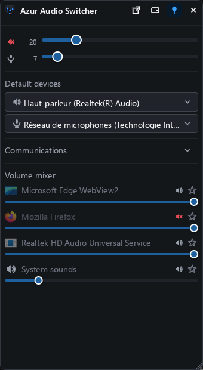

# Azur Audio Switcher

Azur Audio Switcher is a small audio panel for Windows that you summon with a keystroke.

It puts the three audio controls you actually reach for in one place: which device the
sound goes to, how loud it is, and how loud *that one application* is. It lives in the
notification area, opens with `Win+Alt+V`, and goes away again when you are done.

<p align="center">
  
</p>

<br>
<p align="center">
  <a href="https://github.com/tonyriviere88/azur-sound-mixer/releases/latest">
    
  </a>
  <a href="https://github.com/tonyriviere88/azur-sound-mixer/releases">
    
  </a>
</p>
<br>

# Features

- **one keystroke away** — `Win+Alt+V` opens and closes the panel, and so does a click on
  its tray icon. It always opens on the screen the mouse is on. The tray icon's menu is how
  you quit.
- **default devices** — pick the output and the input device that every ordinary sound on
  the machine uses.
- **communications devices** — Windows keeps a second pair of devices for calls, and this
  section sets them. It is independent of the one above, so a headset chosen for calls stays
  chosen when you move your music to the speakers — and a headset picked only above does not
  take your calls with it.
- **master volume** — output and input, on the same scale as the Windows volume slider, so
  a number here matches the number there.
- **mute** — click any speaker or microphone glyph: the two masters and every application.
  Red when muted.
- **volume mixer** — every application playing sound, with its real name and icon, its own
  slider and its own mute.
- **level meters** — a thin bar under each slider shows which of them is making the noise.
- **favourites** — star an application to keep it at the top of the mixer.
- **follows Windows** — press a volume key on the keyboard, or move a slider in Windows' own
  mixer, and the panel moves with it.
- **stay open** — the 📌 toggle in the header. On, the panel stays above other windows until
  you dismiss it; off, it hides as soon as you click somewhere else.
- **where it opens** — the 🖱 toggle in the header: centred under the mouse, or where you
  left it, in the same corner of whichever screen the mouse is on.
- **resizable** — drag any edge or corner; the mixer list takes the extra room.
- **Windows sound settings** — the ⧉ button in the header opens the Windows sound page, for
  everything past picking a device.
- **remembered** — the two toggles, your favourites and whether the Communications section
  is open are kept between runs, in plain text files under `%APPDATA%\Azur Audio Switcher`.

## Command line

```
azur-audio-switcher.exe                       starts in the tray: Win+Alt+V opens it
azur-audio-switcher.exe --show                and open the panel straight away
azur-audio-switcher.exe --hotkey ctrl+alt+f9  use another keystroke
azur-audio-switcher.exe --no-stay-open        hide when it loses the focus, for this run
azur-audio-switcher.exe --at-pointer          open under the mouse, for this run
azur-audio-switcher.exe --last-position       open where you left it, for this run
azur-audio-switcher.exe --overlay             draw over a fullscreen game without taking
                                              its focus (no Esc, no dragging)
azur-audio-switcher.exe --profile <name>      keep separate settings and favourites
```

To start it with Windows, put a shortcut to it in your Startup folder (`Win+R`,
`shell:startup`).
